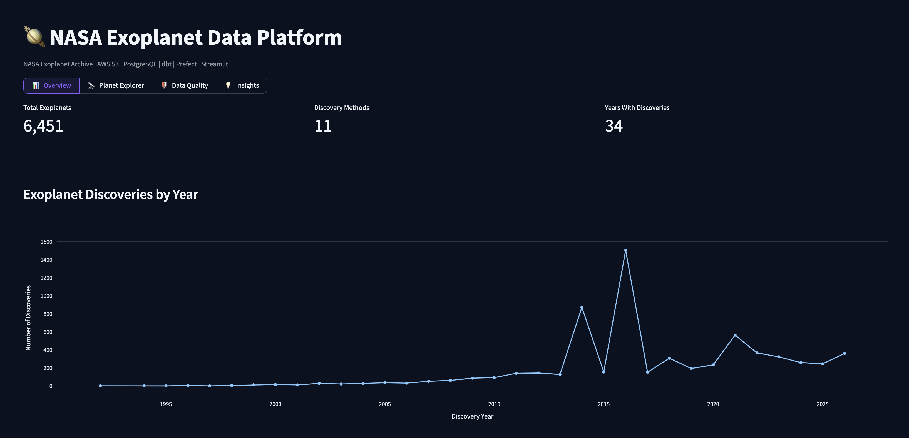
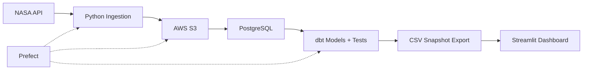

# NASA Exoplanet Data Platform

**An end-to-end data engineering pipeline and interactive analytics dashboard built with Python, AWS S3, PostgreSQL, dbt, Prefect, and Streamlit.**

[**Live Dashboard**](https://nasa-exoplanet-explorer.streamlit.app) · [**NASA Data Source**](https://exoplanetarchive.ipac.caltech.edu/)

## Overview

Built a data platform that ingests NASA exoplanet records, stores raw snapshots in AWS S3, transforms and validates data in PostgreSQL using dbt, and publishes interactive analytics through Streamlit.



**Published dataset:** 6,451 exoplanets · 11 discovery methods · 34 discovery years · 6/6 dbt tests passing


## Architecture



Prefect coordinates ingestion, loading, and dbt transformations with task retries and a locally configured daily schedule.

**Pipeline:** NASA TAP API → Python → S3 → PostgreSQL → dbt → published CSV snapshots → Streamlit Cloud.

Prefect provides task retries and a daily schedule for the ingestion, loading, and transformation workflow.

## Interactive Dashboard

[**Explore the deployed dashboard →**](https://nasa-exoplanet-explorer.streamlit.app)

| Section | Capabilities |
|---|---|
| 📊 Overview | Discovery trends, detection methods, and summary metrics |
| 🔭 Planet Explorer | Search, filter, visualize, and export exoplanet records |
| 🛡️ Data Quality | Completeness, missing values, duplicates, and dbt test results |
| 💡 Insights | Discovery trends and planetary characteristic distributions |

The dashboard renders only the selected section to improve responsiveness.

## Tech Stack

| Layer | Tools |
|---|---|
| Ingestion & storage | Python, NASA TAP API, AWS S3, Boto3 |
| Database & modeling | PostgreSQL, SQL, dbt |
| Orchestration | Prefect |
| Visualization | Streamlit, Plotly, Pandas |
| Deployment | GitHub, Streamlit Community Cloud |

## Engineering Highlights

- **Cloud ingestion:** Fetches NASA data and preserves timestamped raw CSV snapshots in AWS S3.
- **Data modeling:** Builds three analytics-ready dbt views for discoveries and planetary characteristics.
- **Data quality:** Runs six automated dbt uniqueness and null checks; all passed in the published validation snapshot.
- **Orchestration:** Coordinates ingestion, database loading, and dbt builds with Prefect task retries and local scheduling.
- **Public deployment:** Serves interactive analytics using versioned data snapshots without requiring an always-on public database.


## Quick Start

The dashboard can be run independently using the included data snapshots:

```bash
git clone https://github.com/addiekochanik-main/NASA_exoplanet_data_platform.git
cd NASA_exoplanet_data_platform
pip install -r dashboard/requirements.txt
streamlit run dashboard/app.py
```

To execute the full data pipeline, configure the required AWS credentials, PostgreSQL database, and dbt profile, then run python src/run_pipeline.py.

## Deployment Design

The public dashboard uses validated CSV snapshots exported from the analytics pipeline, allowing visitors to explore the application without access to the underlying infrastructure.

This was a deliberate choice to provide an accessible, low-maintenance live demo while keeping the full ingestion and transformation pipeline separate.

The dashboard is interactive, but its data reflects the latest published snapshot rather than a real-time connection. Future improvements include automated refreshes and incremental ingestion.

---

**Data source:** [NASA Exoplanet Archive](https://exoplanetarchive.ipac.caltech.edu/) · Independent educational portfolio project.
